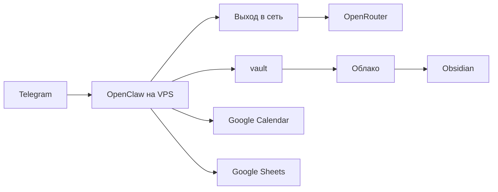

# Jarvis

Личный ассистент в Telegram. Он записывает траты, задачи, идеи и фильмы в vault, а встречи с часом ставит в Google Calendar. Vault открывается в Obsidian: сервер выгружает его в облако, на компьютере Obsidian читает эту копию.

Цель — чтобы сообщение с телефона становилось одной заметкой с понятными полями, без выдуманных сумм и без переписывания старых файлов. Репозиторий хранит сам инструмент. Личные числа, папки и секреты живут только на сервере.

Живой сервер, под который собран установщик: Ubuntu 24.04, Node 24.22.0, OpenClaw 2026.10.4.

## Архитектура



OpenClaw слушает Telegram и пишет в `/home/openclaw/vault`. Модели идут через OpenRouter: обычный текст — Claude Haiku, фото чека и утренняя сводка — Claude Sonnet, голос — Whisper. Для Claude включены `data_collection: deny`, порядок провайдера `anthropic` и выключенные fallback. Инструменты `exec` и `browser` выключены: бот меняет заметки файловыми инструментами, не командами оболочки.

Календарь — локальный скрипт `calendar-v3-mcp.mjs` к Google Calendar API v3. Официальный Calendar MCP в конфиге выключен: для личного Gmail он закрыт программой Developer Preview.

Таблица бюджета — локальный скрипт `sheets-mcp.mjs`. Та же трата, что легла в `finance/YYYY/`, дописывается строкой на лист Daily. Вопрос «сколько осталось на неделю» читает лист Notify. «Сколько потратил вчера» по-прежнему считается по файлам vault.

Выход в сеть на этом VPS — Sota, sing-box со стеком `gvisor`. Это личный выбор владельца, а не часть ассистента. Достаточно любого пути, с которого с сервера открываются Telegram и OpenRouter. В репозитории лежат unit `sota-tun` и `deploy/sbin/sota-preserve-ssh.sh`: перед туннелем скрипт оставляет ответы SSH в таблице `main`. Сам конфиг sing-box на сервере, в git его нет.

Синк vault один: VPS → облако, раз в минуту, `rclone`. Обратного синка нет. В поставке remote называется `dropbox`, папка внутри него — `DROPBOX_DEST`. На этом сервере облако — Dropbox. Obsidian на компьютере открывает ту же папку.

## Как устроены записи

Один тип сообщения — один новый файл. Сначала копия в `inbox/`, затем постоянная заметка. Сумму, дату и категорию бот не выдумывает: нет поля — один вопрос, файла нет. Уже существующую заметку он не переписывает и не удаляет, пока в Telegram нет явного «да».

Встреча, у которой назван час, пишется только в календарь. В `tasks/` она не дублируется.

Общие правила — `SOUL.md`, `system/AGENTS.md` и `SKILL.md`. Если рядом лежит `local.md`, личные числа и папки берутся оттуда и в общий файл не переносятся. Деплой `local.md` не копирует и не удаляет. Пример пустых полей — `local.md.example`.

Версия всего инструмента одна: файл `VERSION` и тег `vX.Y.Z`. Патч — уточнение правила. Минор — новый модуль или новое поведение. Мажор — ломается формат заметок. После выкладки в vault лежит маркер `system/VERSION`.

## Vault

Пример дерева. Имена личных папок архива сюда не входят: их список на сервере в `system/local.md`.

```text
vault/
  SOUL.md
  USER.md
  inbox/
  finance/2026/
  tasks/
    Board.md
  ideas/
  media/movies/
  system/
    AGENTS.md
    local.md
    VERSION
  skills/
    expense-tracker/
      SKILL.md
      local.md
    obsidian-tasks/
      SKILL.md
      local.md
```

| Сообщение | Папка | Имя файла |
|---|---|---|
| Сырой вход | `inbox/` | `YYYY-MM-DD-HHMM-кратко.md` |
| Трата | `finance/YYYY/` | `YYYY-MM-DD-кратко.md` |
| Задача | `tasks/` | `YYYY-MM-DD-кратко.md` |
| Идея | `ideas/` | `кратко.md` |
| Фильм | `media/movies/` | `название.md` |

`tasks/Board.md` — доска. Колонки: Backlog, Todo, In Progress, Done.

Писать лучше боту. Obsidian удобен, чтобы читать и искать. Направление синка — с VPS в облако, поэтому заметка, которая есть только в облаке, следующим проходом может исчезнуть. Папки, которые синк не должен трогать, перечислены в exclude на сервере. В репозитории это комментарий-пример: `deploy/rclone/vault-exclude.txt`.

## Как говорить с ботом

Коротко и по одному делу. «Кофе 350 нал сегодня». «Купить молоко до начала ноября». «Поставь встречу на завтра в 15:00». «Сколько я потратил вчера». «Сколько осталось на неделю».

Когда дело закрыто — трата лежит в файле, встреча стоит, вопрос отвечен — отправь отдельным сообщением `/reset`. Так следующая задача не унаследует старый контекст: чужую сумму, вчерашнюю дату или прежний отказ инструмента. Команда одна, без продолжения в той же строке. Новое дело — следующим сообщением.

`/new` тоже начинает новую сессию этого чата. Для закрытой задачи достаточно `/reset`.

| Команда | Когда |
|---|---|
| `/reset` | Задача закрыта, дальше другое дело |
| `/new` | Нужна новая сессия этого чата |
| `/stop` | Ответ ещё идёт, и он не тот |
| `/compact` | Тот же разговор длинный, сессию ещё рано сбрасывать |
| `/model` | Какие модели есть и какая сейчас |
| `/model haiku` | Обычный текст, это модель по умолчанию |
| `/model sonnet` | Сложный вопрос в этом чате |
| `/status` | Состояние бота |
| `/help` | Список команд на этом gateway |

Голос и фото бот принимает. Сомнительная сумма на фото — один вопрос, файла нет. Утренняя сводка сама приходит в 08:00 по Москве, модель Sonnet, отдельная сессия: просроченные задачи и траты за вчера. Новых файлов она не создаёт. Периодический heartbeat выключен: на VPS с 2 ГБ памяти он занимает главную сессию и обрывается по таймауту.

## Команды, которые повторяются

С компьютера, из корня репозитория:

```sh
make check
make deploy
make deploy HOST=другой-ssh-хост
```

`make check` смотрит файлы из git. Перед коммитом: `git add`, затем `make check-index`. `make deploy` выкладывает только эти файлы в `/opt/jarvis` на VPS и запускает обновление. `plans/`, секреты и `local.md` туда не попадают.

На уже работающем VPS:

```sh
make update
make morning ENV=/путь/к/env-файлу
```

`make update` обновляет правила, скрипты календаря и таблицы, unit-файлы. Ubuntu заново не ставит. Секреты, живой `openclaw.json` и `local.md` не перезаписывает. `USER.md` копирует только если файла ещё нет. Пока на сервере нет `system/local.md`, обновление останавливается. Сервер `sheets` в живой `openclaw.json` добавляется отдельно, затем `systemctl --user restart openclaw-gateway.service` от пользователя `openclaw`.

Первая установка нового сервера — `make install ENV=/путь/к/env-файлу`. Текущий уже работающий VPS этим не ставить.

## Чего в git нет

- `plans/` — дневник разработки
- `credentials/` — секреты
- `*.env` и `*.key`
- `local.md`, `agent/private/`, `deploy/personal-denylist.txt`
- vault
- `calendar-v3.json` — refresh token календаря
- `google-sheets.json` и `google-sheets.env` — ключ сервисного аккаунта и id копии таблицы
- `rclone.conf` — токен облака
- `/var/lib/sota-connect/singbox.json` — ключи туннеля

Пример ключей без значений: `deploy/env.example`. Там `OPENROUTER_API_KEY`, `TELEGRAM_BOT_TOKEN`, `TELEGRAM_OWNER_ID`, `DROPBOX_DEST`, `GOOGLE_CALENDAR_CLIENT_ID` и `GOOGLE_CALENDAR_CLIENT_SECRET`. Id копии таблицы — `GOOGLE_SHEETS_SPREADSHEET_ID` в `google-sheets.env`, этот файл на сервер кладётся вручную.

`make check` ловит в публичных файлах почту, IPv4, `tg:` с длинным числом и пути облака. Свой список строк — `deploy/personal-denylist.txt`, сам файл в git не входит.

## Ручные шаги

Пока их нет, установщик ставит базу и останавливается.

1. Выход в сеть, с которого открываются Telegram и OpenRouter. На этом сервере это Sota: конфиг sing-box в `/var/lib/sota-connect/singbox.json`, mode `600`. В git файла нет.
2. rclone. У пользователя `openclaw` remote с именем `dropbox`.
3. Календарь. `node /home/openclaw/.openclaw/calendar-v3-mcp.mjs login`. Refresh token ляжет в `~/.openclaw/calendar-v3.json`.
4. Таблица. Ключ сервисного аккаунта в `/home/openclaw/.openclaw/google-sheets.json`, id копии в `/home/openclaw/.openclaw/google-sheets.env`. Оба файла mode `600`. `update.sh` их не копирует и живой `openclaw.json` не правит.
